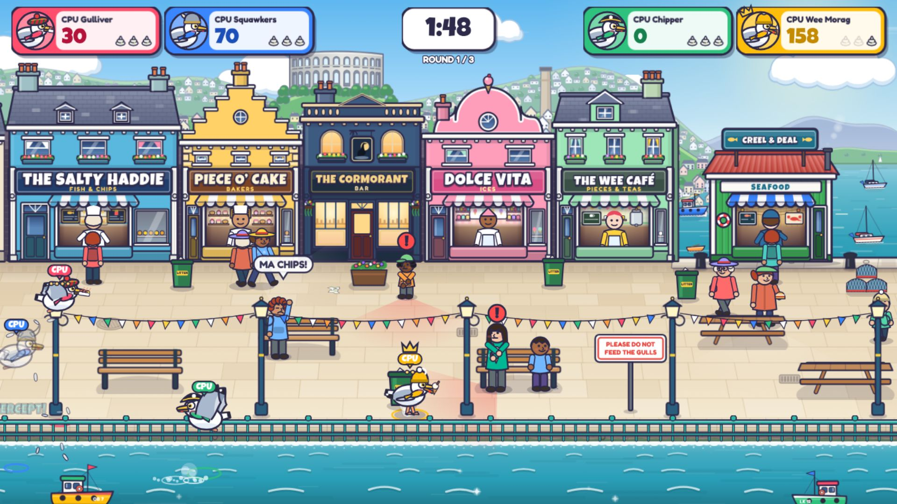
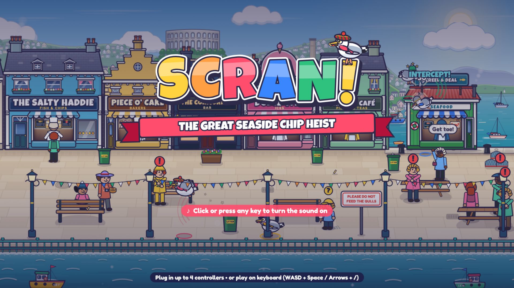
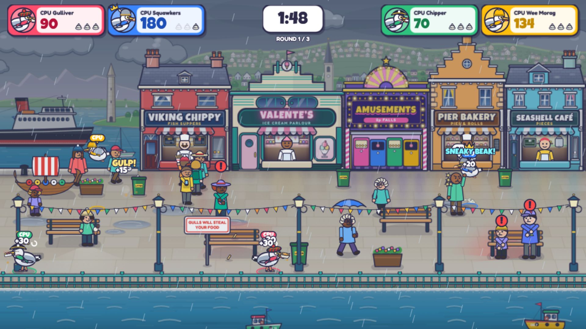

# SCRAN! — The Great Seaside Chip Heist

A cute, colourful, chaotic **1–4 player local seagull brawler** set on a busy Scottish seaside promenade.
You are a herring gull. The prom is heaving with tourists clutching fish suppers, weans with ice creams
and grannies with pies. Nick their scran, eat it before your rivals knock it out of your beak, poop on
anyone who sees you coming — and be the gull with the fullest belly when the whistle blows.

*"Scran"* is Scots for food.

| Title screen (live attract mode) | Largs Prom: the ferry's in and it's chucking it down |
|---|---|
|  |  |

---

## Playing

**No install, no build, no asset files.** Everything (art, music, sound) is generated in code.

1. Open `index.html` in a modern browser (Chrome, Edge, Firefox or Safari). It runs straight from
   `file://`. If your browser is fussy, serve the folder instead:
   `python3 -m http.server 8000` and visit <http://localhost:8000>.
2. Plug in up to **four controllers** (Xbox, PlayStation, Switch Pro, or any pad the browser reports
   with the standard mapping). Press a button once the page has focus so the browser wakes the pad up.
3. **Click or press any key once** to switch the sound on (browsers block audio until you interact
   with the page; a controller press alone doesn't count).
4. Go fullscreen with **F11** or *Options → Fullscreen*.

No controllers? Two players can share a keyboard, and empty slots are filled with CPU gulls.

### Playing on a phone or tablet

You need a controller: there are no on-screen touch controls. Phones can't open a folder of local
files, and browsers only hand controllers to pages served over **HTTPS**, so host the game first
(GitHub Pages or any static host) and open that link.

1. Pair the controller with the phone over Bluetooth (Xbox, PlayStation and Switch Pro pads all work
   on recent iOS and Android).
2. Open the game's HTTPS link in **Safari** (iPhone/iPad) or **Chrome** (Android) and hold the phone
   **sideways**. In portrait the game pauses and asks you to turn the phone.
3. **Tap the screen once.** This switches the sound on and, on Android, goes fullscreen in landscape.
   Then press a button on the controller so the browser notices it.
4. Optional: *Add to Home Screen* for an app icon that launches full-screen. On iPhone, Safari can't
   make a page fullscreen any other way.

While the game is open it asks the phone to keep the screen awake, so it won't dim when you're only
using the controller. Several controllers can pair with one phone, but four players will be happier
on a TV or laptop screen.

### Controls

| Action | Controller | Keyboard 1 | Keyboard 2 |
|---|---|---|---|
| Move | Left stick / D-pad | `W A S D` | Arrow keys |
| Flap / take off (hold to glide) | **A** | `Space` (or `K`) | `/` (or `Num 0`) |
| Peck · **Swoop** (in the air) · **Eat** (hold while carrying) | **X** | `F` (or `J`) | `.` (or `Num 1`) |
| Poop | **B** | `G` (or `L`) | `,` (or `Num 2`) |
| Wings-up dash (hold to keep running) | **Y** / RB / RT | `Left Shift` (or `I`) | `Right Shift` (or `Num 3`) |
| Squawk | **LB** / LT | `Q` (or `U`) | `;` (or `Num +`) |
| Pause | Start | `Esc` | `Enter` |

Menus: stick / D-pad / WASD / arrows to move, **A** / Space / Enter to select, **B** / Esc to go back.

### Getting into a game

**Play** → in *Choose Yer Gull* each player presses **A** (or Space / Enter) to join, picks a hat with
◀ ▶, and presses **A** again to ready up. **Y / Shift** changes how many CPU gulls fill the empty
slots, **LB / Q** changes their skill. Then **Start / Enter** → pick **Oban Bay**, **Largs Prom** or
**Surprise Me**.

A match is best-of-3 rounds of 2 minutes by default (change both in **Options**).

---

## How to play

### Score by *eating*
Snatch food, then **hold Peck while standing on something** to gobble it bite by bite — every bite
scores. Small scraps (chips, crusts, fish bones) are swallowed instantly.

| Scran | Bites × points | Total |
|---|---|---|
| Golden Supper (event) | 6 × 50 | **300** |
| Fish supper | 5 × 30 | 150 |
| Langoustines | 4 × 30 | 120 |
| Poke o' chips | 4 × 20 | 80 |
| Pokey hat (ice cream — melts if dropped!), Scotch pie | 3 × 20 | 60 |
| Sausage roll, doughnut, jeely piece, scone | 2 × 20–30 | 40–60 |
| Bin scraps & dropped chips | 1 × 8–20 | 8–20 |

Bonuses: **+10** for any steal, **+20 Sneaky Beak** if they never saw you coming, **+30 Counter
Heist** for nicking an order while the shopkeeper's back is turned, **+10** per successful poop.
The last 20 seconds are the **Final Frenzy — double points**.

### Sneaking
- Folk see what's **in front of them** — the faint cone on the ground. **?** means they're getting
  suspicious; **!** means they're guarding their food and will **slap** you if you get close.
- Come at them from **behind**, or **swoop** from above. Gulls high in the sky are easy to miss.
- **Poop on heads**: they stop to wipe it off, can't see anything, and might drop their scran.
- **Squawk** near weans and they may drop their ice cream in fright — but adults turn to look.
- **Shopkeepers** turn their backs to cook. That's your moment to swipe an order off the counter.
- **Peck bins** to rake out scraps, or **dash into them** to knock them over and spill the lot.
- Umbrellas (in the rain) block swoops and poop from above.

### Brawling
- **Peck**, **dash** or **swoop** into a rival to knock their food loose. Swoop right through them
  and you'll catch it mid-air — **Intercept!**
- **Poop** on a rival to *splat* them: they slow down and drop what they're carrying.
- Carrying food makes you heavy and slow. Eat somewhere safe: **rooftops, lamp posts, the railings,
  benches, picnic tables**.
- The leader wears a **crown** — and folk spot crowned gulls more easily.

### Seaside chaos (random events each round)
**Ferry's in!** (a boatload of hungry tourists) · **Rain shower** (brollies up, folk run for it) ·
**Fishing boat** (scraps tossed onto the prom) · **Golden Supper** (Big Tam's got the good stuff) ·
**Dog off the lead** (Hamish the Westie hunts gulls) · **Piper on the prom** (everyone stops to
watch — and stops watching their chips) · **Teatime rush** (queues out the door).

### CPU gulls
**Chick** (easy, dawdles), **Gull** (a fair fight), **Gannet** (flanks people, poop-bombs anyone who
spots it, and mugs carriers).

---

## Under the hood

Plain HTML5 Canvas 2D + Web Audio + Gamepad API, classic `<script>` files sharing one `SG` namespace.

| File | What it does |
|---|---|
| `js/util.js` | Constants, maths/colour helpers, sprite cache, saved settings |
| `js/stages.js` | Oban Bay and Largs Prom layouts (shops, props, bay, landmarks) |
| `js/input.js` | 4 gamepads (with rumble) + 2 keyboard layouts as uniform devices |
| `js/audio.js` | Synthesised SFX, ambience loops, stingers and four original folk tunes |
| `js/art.js` | Procedural cartoon gulls, people, shopkeepers, dog, food, props, FX |
| `js/backdrop.js` | Pre-rendered painted stage backdrops with animated sky, sea and ferry |
| `js/items.js` | Food table, loose food, poop projectiles, particles, floating text |
| `js/gull.js` | Gull movement & actions (walk, dash, flap/glide, swoop, peck, eat, poop, squawk) |
| `js/people.js` | People (vision, alertness, shielding, swatting, queueing, eating), shops, the dog |
| `js/world.js` | The round: 2.5D physics boxes & perches, depth sorting, interactions, events, scoring |
| `js/ai.js` | CPU gull brain — produces the same input a controller would |
| `js/ui.js` | UI widgets and the in-game HUD |
| `js/scenes.js` | Title (live attract mode), menus, lobby, stage select, game, results, podium |
| `js/main.js` | Boot, scaling, adaptive resolution, scene manager, main loop |

Add `?debug` to the URL to show any runtime error on screen.

See **[DESIGN.md](DESIGN.md)** for the research into other brawlers that shaped the game.
